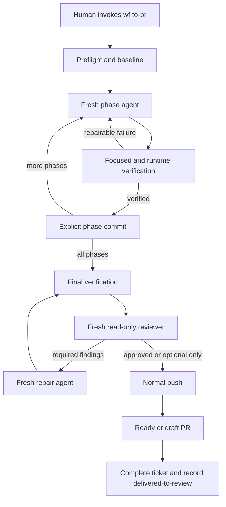

# Plan Brief

## Goal And Outcome

Add `wf to-pr`, a ticket-scoped autonomous path from a human-approved specification and plan to a locally verified, independently reviewed pull request.

The command ends at delivered to review. It does not claim CI success, merge, deployment, or production delivery.

## Current State

The workflow already supports implementation, review, and completion, but each operation requires a separate human invocation. It has no orchestration journal, automated Git checkpointing, push behavior, or pull request creation.

## Main Changes

### Command And State

- Add `to-pr` routing and a dedicated command reference.
- Add `TO-PR.md` as a resumable execution journal.
- Validate journal lifecycle, state, approved-input identities, baseline identity, and delivered PR metadata.

### Phase Execution

- Use a fresh implementation agent for each plan phase.
- Keep bounded repairs with the active phase agent.
- Require objective phase evidence before an explicit ticket-owned commit.
- Resume from verified commits without repeating or rewriting phases.

### Safety And Review

- Preserve unrelated dirty-worktree changes and block overlapping paths.
- Run final cross-phase verification.
- Use fresh read-only reviewers.
- Permit one fresh required-finding repair pass and one fresh re-review.

### Git And Pull Request Delivery

- Keep phase and review-fix history append-only.
- Push normally without force.
- Create a ready PR when all evidence exists or a qualified draft PR when required runtime verification is unavailable.
- Apply existing completion readiness, move the ticket to done, and record delivered-to-review.

### Distribution

- Update repository documentation, landing content, presentation, static contracts, validator fixtures, and manual conformance cases.

## Architecture And Data Flow

`to-pr` is a finite coordinator state machine, not an unbounded prompt loop. Repository files and Git commits hold durable state; fresh agents perform bounded work.

`TO-PR.md` records approved inputs, baseline ownership, active state, attempts, commit ledger, verification limitations, blockers, and PR delivery. `SPEC.md` and `PLAN.md` remain authoritative; `PROGRESS.md` and `REVIEWS.md` remain evidence records.

The journal must use a documented state-transition table rather than free-form status text. It must retain enough immutable identity and delivery metadata to resume safely after interruption between push, PR creation, validation, and lifecycle movement. Baseline isolation is path-set based: staged, unstaged, and untracked paths are captured before execution, planned and observed overlaps block, and only explicit ticket-owned paths may be staged.

The confirmed journal states are `preflight`, `phase-N`, `final-verification`, `review`, `review-repair`, `delivery`, `blocked`, and `delivered-to-review`. Fresh-agent dispatch and pull-request creation are required host capabilities; missing capabilities stop the command rather than triggering a session or CLI fallback.

## Phase Map

1. **Phase 1: Command and journal foundation** - add routing, journal schema, lifecycle states, validator support, and focused fixtures.
2. **Phase 2: End-to-end orchestration** - define fresh-agent phase execution, verification, repair, commits, resume, independent review, push, PR creation, and completion.
3. **Phase 3: Distribution and conformance** - synchronize all user-facing surfaces and run full automated and manual verification.

## Important Decisions

- Invocation approves the current spec and plan. Separate approval metadata was rejected as unnecessary ceremony.
- Fresh agents are required, not optional. Hosts without delegation support must stop cleanly.
- The design adopts Ralph-style fresh context and filesystem memory, but rejects an unbounded retry loop.
- Dirty checkouts are allowed only with strict baseline ownership and path-overlap blocking.
- Phase commits remain immutable. Review repairs use separate append-only commits because history rewriting conflicts with dirty-worktree safety.
- Reviewers cannot edit code. One separate repair pass handles required findings before one final re-review.
- Normal push is mandatory. Force push, stash, reset, rebase, and automatic conflict resolution are forbidden.
- Fresh-agent dispatch and pull-request creation are required host capabilities with explicit adapters and diagnostics; `to-pr` never guesses a CLI, remote, or target branch.
- `to-pr` was chosen over `ship` because the command stops at a pull request and must not imply production deployment.

## User-Visible Changes

- New command: `wf to-pr <change> <ticket>`.
- New ticket-local artifact: `TO-PR.md`.
- Successful runs create a ready-for-review PR and move the ticket to `4.done/`.
- Environment-limited runtime verification creates only a draft PR with explicit required follow-up.
- Interrupted runs can resume from the last verified phase commit.

## Risks And Rollout

- Compatibility: existing commands and tickets remain valid; only `to-pr` requires fresh-agent orchestration.
- Rollout: add the command as opt-in and validate it in disposable repositories before production use.
- Rollback: revert the route, references, validator extension, tests, and documentation together. Existing workflow data without `TO-PR.md` is unaffected.
- Main risk: verification remains a proxy for intent. Independent review, runtime evidence, integrity checks, and hard escalation boundaries reduce but do not eliminate that risk.
- Delivery interruption is a separate recovery risk: the journal must record push and PR results before lifecycle completion so reruns cannot duplicate or falsely claim delivery.

## Testing Summary

- Add failing static contracts before routing and reference changes.
- Add valid and invalid `TO-PR.md` fixtures before validator support.
- Exercise success, dirty baseline, overlap, repair exhaustion, interruption/resume, review repair, draft PR, and push-conflict cases with temporary local directories created by the test process; do not create temporary GitHub repositories.
- Exercise PR-creation and delivery-recovery through the host integration only when an authorized destination is available. Otherwise record those cases as manual-only evidence with the exact limitation.
- Run `./scripts/verify.sh` after all changes and inspect rendered HTML documentation.

## Human Review Focus

- Confirm the proposed `TO-PR.md` frontmatter fields are sufficient for deterministic resume without becoming an unnecessary second source of truth.
- Confirm applying `wf complete` after PR creation matches the intended meaning of `4.done/`.
- Review whether path-level dirty-baseline blocking is sufficiently safe or whether the first release should require isolated worktrees.
