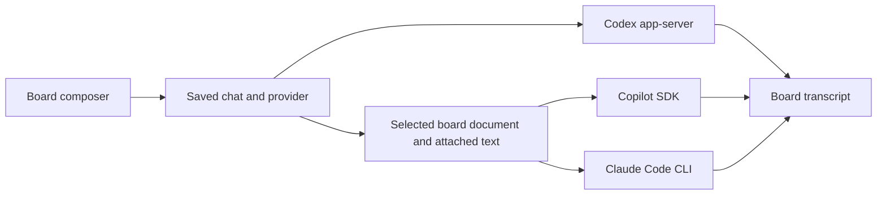

# Plan brief

The provider choice belongs to a conversation. Before sending a first message or starting a new chat, a developer chooses Codex, GitHub Copilot, or Claude Code. Reopening a conversation restores its provider and session.

Copilot and Claude discuss only the context sent by the board. Codex can also search the repository and propose workflow actions for approval. SQLite identifies old chats as Codex during migration. The board launches only the selected runtime.

The delivery covers selection and history, both provider integrations, then review and verification. The browser and HTTP tests exercise routing, reopening, file handling and Stop. Live smoke checks distinguish a working provider connection from a machine that still needs credentials.
