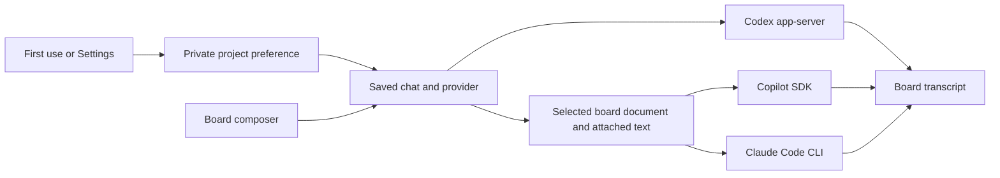

# Plan brief

The first time someone opens a project's board, they can choose Codex, Claude Code, or GitHub Copilot. Later visits load the saved choice. The Settings control changes which provider handles new chats. Older conversations retain their own history and can be continued when their provider is selected again.

Copilot and Claude discuss only the context sent by the board. Codex can also search the repository and propose workflow actions for approval. SQLite identifies old chats as Codex during migration. The board launches only the selected runtime.

Linked worktrees share the choice. Conversations and native sessions stay scoped to the checkout. The board writes its provider data to the user's external state directory. Browser and HTTP checks cover first use, switching, project isolation, routing, reopening, file handling and Stop. Live smoke checks record each provider’s sign-in and inference results.
