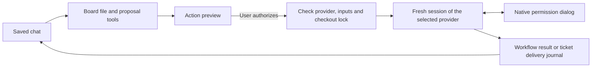

# Plan brief

First, the three chat providers get the same repository lookup and proposal tools. Then a click on **Authorize and run** starts a separate session with the conversation's own provider. The checkout owns execution and receipts, and the original conversation keeps its session.

Claude uses its CLI's bidirectional stream and Copilot uses its SDK's custom tools and native workers. Both receive the canonical packaged wf skill on approval. Verify the native integrations in disposable checkouts, exercise denial and restart, inspect the actual packaged board, and keep external sign-in and real publication evidence explicit.
